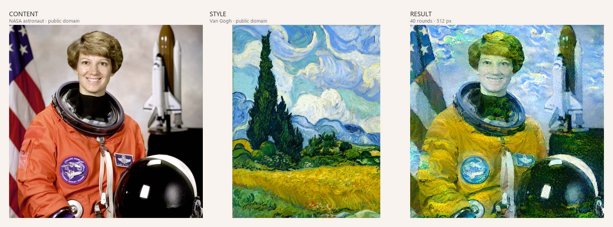
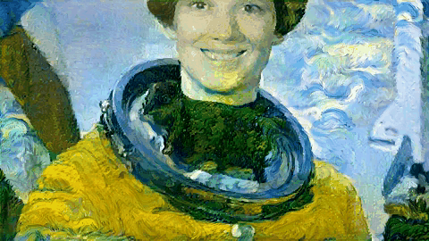
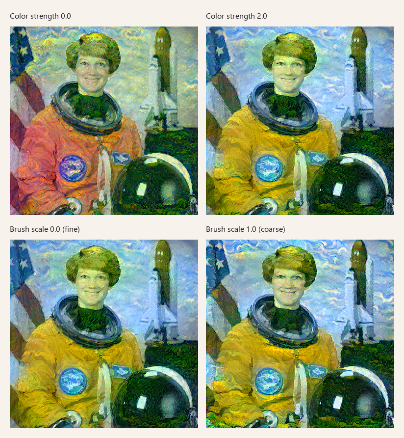

# Neural Style Studio

[](https://www.python.org/)
[](https://pytorch.org/)
[](https://streamlit.io/)
[](LICENSE)

**An interactive, reproducible neural style transfer app for images and short videos.**
Upload a content photo or a video and a style painting, tune color and brushstroke
parameters with sliders, and download the stylized result. Images use VGG19 + Gram
matrices + L-BFGS. Video adds Farneback optical flow, occlusion-aware warping, and a
temporal consistency loss to suppress flicker.

[中文说明](README.zh-CN.md)



> Content: NASA astronaut portrait (public domain). Style: Vincent van Gogh,
> *Wheat Field with Cypresses* (1889, public domain). Result: default settings,
> 40 rounds, 512 px. See [asset credits](assets/CREDITS.md).

## Why this project

Most neural style transfer demos are either a notebook with hard-coded paths or a
black-box web service. This project keeps the original optimization-based algorithm but
makes it:

- **Interactive** — every important loss weight and input scale is a slider.
- **Inspectable** — the engine is a standalone Python module, not buried in UI code.
- **Temporal-aware** — video mode aligns frames with optical flow and penalizes flicker.
- **Reproducible** — fixed seed, documented defaults, tested environment, and a CLI.
- **Portable** — runs locally, in Docker, or on CPU; no `d2l` or `matplotlib` dependency.
- **Reusable** — the demo images are public domain, and the code is MIT licensed.

## Features

**Image page**

- Upload content/style images (PNG, JPG, JPEG, WEBP, BMP); transparent images are
  composited on white.
- 7 core sliders: style strength, color strength, brush strength, brush scale,
  content preservation, TV smoothness, and optimization rounds.
- 4 one-click presets: Van Gogh impasto, color burst, fine brush, and quick preview.
- Live progress, intermediate previews, final loss chart, and parameter report.
- Download the result as PNG.

**Video page**

- Upload MP4/MOV/M4V/AVI/MKV/WEBM and a style image.
- Farneback forward/backward optical flow with a confidence mask for disocclusions.
- Temporal consistency loss plus optical-flow warm start between frames.
- Separate knobs for first-frame rounds, per-frame rounds, temporal weight, max frames,
  video resolution, and flow quality.
- **First-frame preview** before committing to a long video run.
- H.264 MP4 output (via bundled `imageio-ffmpeg`) for in-browser playback; falls back to
  OpenCV `mp4v` if ffmpeg is unavailable.
- Output is silent (audio is not muxed yet).

**General**

- Automatic CUDA acceleration; CPU fallback with a warning.
- Headless CLI for images and Docker support.
- Unit tests plus optional real image/video engine smoke tests.
- GitHub Actions CI for lint, tests, and Docker build.

## Quick start

### Requirements

- Python 3.10 or newer
- PyTorch 2.0+ and torchvision 0.15+
- OpenCV 4.8+ and imageio-ffmpeg 0.5+ (installed by `requirements.txt`)
- Optional: an NVIDIA GPU with a CUDA-enabled PyTorch build
- ~600 MB free disk space for the VGG19 weights on first run

### Local install

```bash
git clone https://github.com/<your-account>/neural-style-studio.git
cd neural-style-studio

python -m venv .venv
# Windows:
.venv\Scripts\activate
# macOS / Linux:
source .venv/bin/activate

# CPU-only PyTorch (replace with a CUDA wheel from pytorch.org if you have a GPU)
pip install torch torchvision --index-url https://download.pytorch.org/whl/cpu
pip install -r requirements.txt

streamlit run app.py
```

Open <http://127.0.0.1:8501>.

On Windows you can also double-click `run_app.bat`. On macOS/Linux:

```bash
chmod +x run_app.sh
./run_app.sh
```

The scripts prefer `.venv` and otherwise use `python`/`python3`.

The first run downloads the 548 MB VGG19 checkpoint to
`~/.cache/torch/hub/checkpoints/vgg19-dcbb9e9d.pth` and caches it for later runs.

### Docker (CPU)

```bash
docker compose up --build
# open http://127.0.0.1:8501
```

or without Compose:

```bash
docker build -t neural-style-studio .
docker run --rm -p 8501:8501 \
  -v neural-style-cache:/home/appuser/.cache/torch \
  neural-style-studio
```

The Docker image installs CPU-only PyTorch to keep it smaller. For GPU inference,
install a CUDA-enabled PyTorch locally (or adapt the base image and install the matching
CUDA wheel). CPU inference works but is significantly slower, especially for video.

### CLI

```bash
# Quick preview: 10 rounds, 384 px
python scripts/stylize.py --steps 10 --size 384 --output outputs/preview.png

# Stronger color, coarser brush
python scripts/stylize.py --steps 30 --size 512 \
  --color 1.5 --brush 1.2 --brush-scale 0.7 \
  --output outputs/colorful.png

# Force CPU
python scripts/stylize.py --device cpu --steps 5 --size 256
```

Run `python scripts/stylize.py --help` for all options.

### Video mode

Open the **视频风格化 / Video Style Transfer** page from the sidebar. Upload a video,
optionally upload a style image (the built-in Van Gogh demo is used otherwise), click
**预览首帧 / Preview first frame** to check the look, then **生成风格化视频 / Generate video**.



The demo GIF above is a short synthetic pan generated with the same pipeline (6 frames,
480 px, 35 first-frame rounds + 8 rounds/frame). Video output is H.264 MP4 and plays in
the browser; audio is not preserved.

| UI label | English | Range / default | Engine parameter | Effect |
| --- | --- | --- | --- | --- |
| 首帧轮数 | First-frame rounds | 10–50 / 35 | `first_frame_steps` | More rounds build a stronger initial brushstroke base |
| 后续帧轮数 | Per-frame rounds | 2–15 / 8 | `frame_steps` | Fewer rounds are faster; too few may drift from the style |
| 时间一致性 | Temporal consistency | 0–500 / 200 | `temporal_weight` | Higher suppresses flicker but can add ghosting/trailing |
| 最大帧数 | Max frames | 8–120 / 36 | `max_frames` | Only the first N frames are processed |
| 视频长边 | Video long edge | 360 / 480 / 640 | `video_size` | Output resolution; lower is much faster |
| 光流精度 | Flow quality | fast / balanced / quality | `flow_preset` | Farneback pyramid levels and window size |
| 遮挡敏感度 | Occlusion sensitivity | 0.05–0.60 / 0.20 | `occlusion_sensitivity` | How quickly temporal locking is dropped at flow disagreements |
| 随机种子 | Random seed | 0–999999 / 42 | `seed` | Noise initialization for the first frame and each warm start |

The first frame runs the normal image optimization. Every later frame:

1. computes backward and forward Farneback flow,
2. warps the previous stylized frame with `cv2.remap`,
3. builds `mask = exp(-k × ||flow_bw + warped_flow_fw||)` to down-weight occlusions,
4. blends `mask × warped_previous + (1 - mask) × current_content` as the warm start,
5. optimizes with the extra loss `temporal_weight × mean(mask × (X - warped_previous)²)`.

Video processing is expensive: the default 36 frames at 480 px take roughly 1.5–2 minutes
on the reference GPU. Start with **Preview first frame**, then use fewer frames or 360 px
while iterating.

### Check your environment

```bash
python scripts/check_env.py
```

It prints Python, torch, torchvision, Streamlit, OpenCV, ffmpeg, CUDA availability, GPU
name, and whether the VGG19 checkpoint and demo assets are present.

## What the sliders do

The UI is currently in Simplified Chinese. The table below maps each label to English.

| UI label | English | Range / default | Engine parameter | Effect |
| --- | --- | --- | --- | --- |
| 风格强度 | Style strength | 0.10–2.00 / 1.00 | `style_weight = 3e6 × value` | Global style intensity; too high can overpower content structure |
| 色彩强度 | Color strength | 0.00–2.00 / 1.00 | multiplier on `relu1_1` / `relu2_1` weights | Shallow features carry color; raise it to move closer to the style palette |
| 笔触强度 | Brush strength | 0.00–2.00 / 1.00 | multiplier on `relu4_1` / `relu5_1` weights | Deep features carry large-scale texture; raise it for impasto/swirl strokes |
| 笔触尺度 | Brush scale | 0.00–1.00 / 0.55 | style input long edge, 512 → 224 px | Smaller style input means larger effective brush strokes |
| 内容保留 | Content preservation | 0.05–2.00 / 0.50 | `content_weight` | Higher keeps mountains, roads, faces, and other structure clearer |
| 画面平滑 | Smoothness | 0.00–1.00 / 0.20 | `tv_weight` | Higher is smoother; lower keeps grain/noise |
| 迭代轮数 | Optimization rounds | 10–60 / 40 | `num_steps` | Each round runs 10 L-BFGS inner iterations |
| 输出长边 | Output long edge | 384 / 512 / 640 px | `output_size` | Output resolution; lower it if VRAM is tight |
| 随机种子 | Random seed | 0–999999 / 42 | `seed` | Controls the noise initialization; fixed seed improves reproducibility |

The five style layers use the notebook's base weights:

```text
relu1_1  relu2_1  relu3_1  relu4_1  relu5_1
  0.05     0.10     0.50     2.50     1.00
```

`relu3_1` sits between color and texture, so it is mixed as
`0.35 × color_strength + 0.65 × brush_strength`.

### Parameter examples



Generated with the same content/style pair at 15 rounds and 384 px. The top row changes
only color strength; the bottom row changes only brush scale. This is a good way to see
that the two controls affect different parts of the style representation.

### Presets

| Preset (UI) | English | Intent |
| --- | --- | --- |
| 梵高·厚涂 | Van Gogh impasto | Stronger deep-layer weights and a smaller style input for bold strokes |
| 色彩冲击 | Color burst | Higher color weight and global style strength |
| 细腻笔触 | Fine brush | Larger style input, fewer rounds, more content preservation |
| 快速预览 | Quick preview | 15 rounds at 384 px for fast iteration |

## How it works

1. A pretrained VGG19 extracts features. The implementation keeps layers up to `relu5_1`,
   uses `relu1_1`, `relu2_1`, `relu3_1`, `relu4_1`, `relu5_1` as style layers, and
   `relu4_2` as the content layer.
2. Max-pooling is replaced with average-pooling, and ReLUs are made non-inplace.
3. Style is represented by Gram matrices:

   ```text
   G = F Fᵀ / (C × N)
   ```

4. The synthesized image minimizes:

   ```text
   L = content_weight × L_content
     + style_weight × Σ layer_weight_l × L_style_l
     + tv_weight × L_TV
   ```

   Both `L_content` and `L_style` are mean squared errors; `L_TV` is total variation.
5. The image starts at `0.7 × content + 0.3 × Gaussian noise` and is optimized in
   normalized VGG input space with L-BFGS (`strong_wolfe`, 10 inner iterations per round).
6. Pixels are clamped to the valid normalized range before each closure and after each
   round. The result is denormalized and converted back to PIL.

This is the original optimization-based style transfer formulation: each output image
requires its own optimization. It is not a feed-forward stylization network, so generation
takes seconds rather than milliseconds.

### Video temporal pipeline

For a frame at time `t > 0`, with the previous **stylized** frame `S_{t-1}` and the current
content frame `C_t`:

```text
flow_bw  = Farneback(C_t → C_{t-1})
warped   = remap(S_{t-1}, flow_bw)
flow_fw  = Farneback(C_{t-1} → C_t)
diff     = ||flow_bw + remap(flow_fw, flow_bw)||
mask     = exp(-occlusion_sensitivity × diff)

init_t   = 0.95 × (mask × warped + (1 - mask) × C_t) + 0.05 × noise

L_temporal = temporal_weight × mean(mask × (X_t - warped)²)
L_total    = L_content + L_style + L_TV + L_temporal
```

The forward/backward flow consistency flags newly exposed regions (where the previous
frame has no reliable correspondence), so those pixels are not forced to match the past.
The first frame uses the normal image initialization (`0.7 × content + 0.3 × noise`) and
more rounds; later frames use the optical-flow warm start and fewer rounds.

Frames are written as H.264/yuv420p MP4 via `imageio-ffmpeg`; if that encoder is
unavailable, the engine falls back to OpenCV `mp4v`. The output has no audio track.

## Reproducibility

### Tested environment

| Component | Version |
| --- | --- |
| OS | Windows 11 |
| Python | 3.13.5 |
| PyTorch | 2.11.0+cu128 |
| torchvision | 0.26.0+cu128 |
| Streamlit | 1.45.1 |
| Pillow | 11.1.0 |
| OpenCV | 5.0.0 (headless) |
| imageio-ffmpeg | 0.8.1 |
| GPU | NVIDIA GeForce RTX 5060 Laptop, 8 GB |

The code also runs on CPU. CI uses Python 3.10 and 3.12 with CPU PyTorch.

### Performance

Approximate timings on the machine above:

| Configuration | Time |
| --- | --- |
| Image: 10 rounds, 384 px | ~3 s |
| Image: 15 rounds, 512 px (square) | ~10 s |
| Image: 40 rounds, 512 px (square) | ~27 s |
| Image: 40 rounds, 512 px (portrait 288×512) | ~18 s |
| Video: 6 frames, 480 px, 35 + 8 rounds/frame | ~26 s |
| Video: 36 frames, 480 px, default settings | ~1.5–2 min (estimated) |

CPU inference is much slower (minutes for 40 image rounds; video is impractical).
Reduce rounds, resolution, or frame count first.

### Determinism

`seed` fixes the noise initialization and is exposed in the UI and CLI. Results are
visually reproducible on the same hardware and library versions, but GPU convolution
algorithms are not guaranteed to be bit-exact across drivers, GPUs, or PyTorch versions.

The VGG19 checkpoint is identified by torchvision's `VGG19_Weights.DEFAULT` and is
downloaded to the standard torch cache directory.

## Project structure

```text
neural-style-studio/
├─ app.py                      # Navigation + image page
├─ ui_video.py                 # Video page: optical flow, preview, result UI
├─ engine_cache.py             # Shared cached VGG19 engine
├─ style_transfer.py           # VGG19 + L-BFGS engine (image + video)
├─ assets/
│  ├─ demo_content.png         # NASA astronaut, public domain
│  ├─ demo_style.png           # Van Gogh, public domain
│  └─ CREDITS.md
├─ scripts/
│  ├─ stylize.py               # Headless image CLI
│  ├─ check_env.py             # Environment diagnostic
│  └─ make_docs_assets.py      # Regenerates README images
├─ tests/                      # pytest suite (image, video, UI render)
├─ docs/images/                # README images and video GIF
├─ .github/workflows/ci.yml    # lint + tests + Docker build
├─ Dockerfile
├─ docker-compose.yml
├─ requirements.txt
├─ requirements-dev.txt
├─ pyproject.toml
└─ LICENSE
```

## Development

```bash
pip install -r requirements-dev.txt

pytest -q          # fast tests, skips the model download
ruff check .       # lint

# Real engine smoke tests (image + short optical-flow video; loads VGG19)
# Windows PowerShell:
$env:RUN_ENGINE_TESTS = "1"; pytest -q
# macOS/Linux:
RUN_ENGINE_TESTS=1 pytest -q

# Regenerate README still images (GPU recommended; video GIF is generated separately)
python scripts/make_docs_assets.py
```

See [CONTRIBUTING.md](CONTRIBUTING.md) for setup details and PR expectations.

## Troubleshooting

**`No module named streamlit` / `No module named torch`**
You are probably using a different interpreter than the one where dependencies were
installed. Activate `.venv` or use `python -m streamlit run app.py`.

**First run seems stuck**
The VGG19 checkpoint is 548 MB. Check the download progress in the terminal. If your
network cannot reach PyTorch's servers, download `vgg19-dcbb9e9d.pth` manually and place
it in `~/.cache/torch/hub/checkpoints/`.

**CUDA out of memory**
Lower the output long edge (384 px for images, 360 px for video), reduce rounds/frames,
or close other GPU processes. The error dialog also suggests this.

**Video mode says OpenCV is missing**
Install the video dependencies:

```bash
pip install -r requirements.txt
# or: pip install opencv-python-headless imageio-ffmpeg
```

**The generated video does not play in the browser**
The preferred output is H.264 MP4. If the environment fell back to OpenCV `mp4v`, the
page shows a warning; download the file and open it in VLC/ffmpeg-based players.

**Video generation is very slow**
This is expected: each frame is optimized separately. Use **Preview first frame**, reduce
`最大帧数`, lower the video long edge, or reduce the per-frame rounds. CPU video is
impractical for anything beyond a few frames.

**The output video has no audio**
Audio muxing is not implemented yet; the video is intentionally silent. Add an ffmpeg mux
step after generation if you need the original soundtrack.

**Port 8501 is already in use**
Use another port:

```bash
streamlit run app.py --server.port 8502
```

**The result is too smooth or too noisy**
Increase `画面平滑` (TV weight) for smoother output, or decrease it for more grain.
Increase `内容保留` if structure is lost; increase `笔触强度` / `笔触尺度` for bolder
strokes.

**Docker build is slow**
The CPU PyTorch wheel is large. The first build downloads it once; subsequent builds
reuse Docker layer cache.

## License and credits

- Code: [MIT](LICENSE).
- Demo content: NASA astronaut portrait, public domain.
- Demo style: Vincent van Gogh, *Wheat Field with Cypresses*, 1889, public domain.
- Documentation images and the video demo GIF are generated from those assets.
- See [assets/CREDITS.md](assets/CREDITS.md) for details. The demo images are not
  covered by the MIT license.

Algorithm inspired by the d2l *Style Transfer* notebook and the original neural style
transfer work:

- Gatys, Ecker, and Bethge. *Image Style Transfer Using Convolutional Neural Networks.* CVPR 2016.
- Simonyan and Zisserman. *Very Deep Convolutional Networks for Large-Scale Image Recognition.* ICLR 2015.

Built with [PyTorch](https://pytorch.org/), [torchvision](https://pytorch.org/vision/),
[Streamlit](https://streamlit.io/), and [Pillow](https://python-pillow.org/).

## Contributing

Issues and pull requests are welcome. Please read [CONTRIBUTING.md](CONTRIBUTING.md)
first, and do not add image assets without a documented license.
