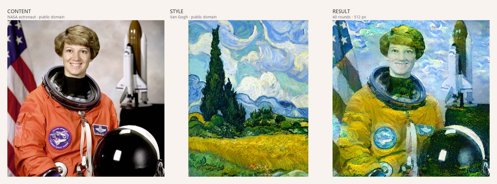
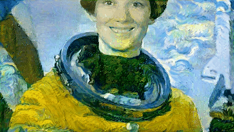
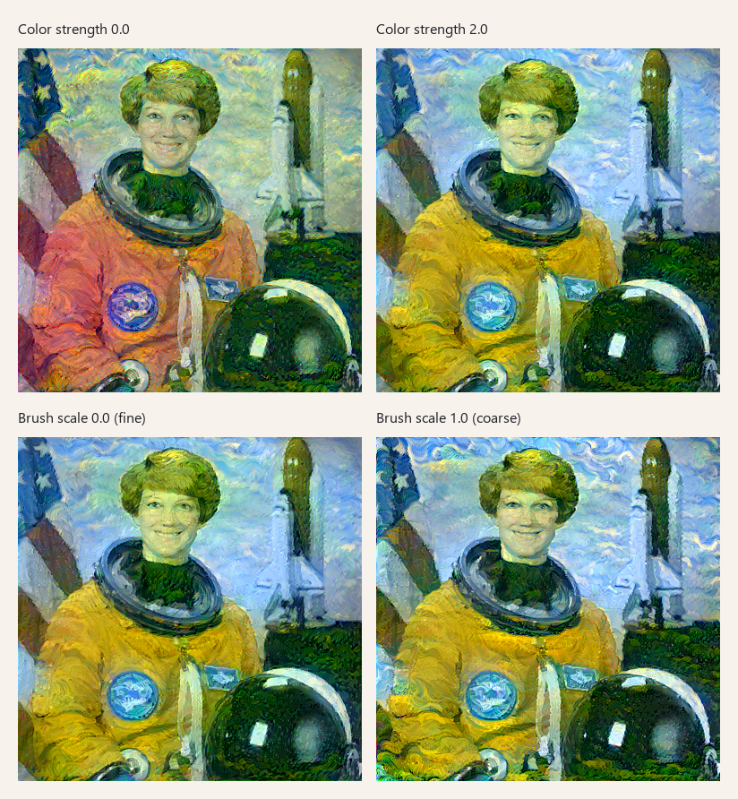

# Neural Style Studio · 风格迁移工作台

[](https://www.python.org/)
[](https://pytorch.org/)
[](https://streamlit.io/)
[](LICENSE)

[English README](README.md)

一个可交互、可复现的**图片 / 短视频神经风格迁移**程序：上传内容图和风格图，拖动滑块调整色彩与笔触；
视频模式额外使用 Farneback 光流和前后向一致性掩码，把上一帧笔触对齐到当前帧，并通过时间一致性损失减少闪烁。
算法基于 VGG19、Gram 矩阵和 L-BFGS，从课程 notebook 整理为独立引擎 + Web 界面，方便其他人直接运行、修改和二次开发。



> 内容图：NASA 宇航员肖像（公有领域）。风格图：梵高《麦田与柏树》（1889，公有领域）。
> 结果：默认参数，40 轮，512px。素材说明见 [assets/CREDITS.md](assets/CREDITS.md)。

## 特性

- **图片页**：上传内容图 / 风格图，支持 PNG、JPG、JPEG、WEBP、BMP；透明背景自动填充白色。
- 7 个核心图片滑块：风格强度、色彩强度、笔触强度、笔触尺度、内容保留、画面平滑、迭代轮数。
- 4 组预设：梵高·厚涂、色彩冲击、细腻笔触、快速预览。
- 实时进度、每 5 轮中间预览、损失曲线、参数报告、PNG 下载。
- **视频页**：上传 MP4/MOV/M4V/AVI/MKV/WEBM，光流对齐 + 时间一致性损失 + 首帧预览。
- 视频专用参数：首帧轮数、后续帧轮数、时间一致性、最大帧数、视频分辨率、光流精度、遮挡敏感度。
- H.264 MP4 输出（imageio-ffmpeg），浏览器可直接播放；不可用时回退 OpenCV mp4v。
- 独立 `StyleTransferEngine`，图片和视频共用同一套 VGG19 / 损失函数。
- 自动使用 CUDA，无 GPU 时回退 CPU。
- 无头图片 CLI、Docker、单元测试、GitHub Actions CI。
- 代码 MIT 协议，示例素材为公有领域，可安心分发。

## 快速开始

### 环境要求

- Python 3.10+
- PyTorch 2.0+、torchvision 0.15+
- OpenCV 4.8+、imageio-ffmpeg 0.5+（requirements.txt 会自动安装）
- 可选：支持 CUDA 的 NVIDIA 显卡
- 首次运行需下载约 548MB 的 VGG19 权重

### 本地安装

```bash
git clone https://github.com/<your-account>/neural-style-studio.git
cd neural-style-studio

python -m venv .venv
# Windows:
.venv\Scripts\activate
# macOS / Linux:
source .venv/bin/activate

# CPU 版 PyTorch；有 NVIDIA 显卡时请先从 pytorch.org 安装对应 CUDA 版本
pip install torch torchvision --index-url https://download.pytorch.org/whl/cpu
pip install -r requirements.txt

streamlit run app.py
```

浏览器打开 <http://127.0.0.1:8501>。

Windows 也可以直接双击 `run_app.bat`；macOS / Linux 可以执行：

```bash
chmod +x run_app.sh
./run_app.sh
```

首次运行会把 VGG19 权重下载到 `~/.cache/torch/hub/checkpoints/vgg19-dcbb9e9d.pth`，
之后复用缓存。

### Docker（CPU）

```bash
docker compose up --build
# 打开 http://127.0.0.1:8501
```

或手动构建：

```bash
docker build -t neural-style-studio .
docker run --rm -p 8501:8501 \
  -v neural-style-cache:/home/appuser/.cache/torch \
  neural-style-studio
```

Docker 镜像使用 CPU 版 PyTorch，体积更小、无需显卡驱动；GPU 用户建议本地安装 CUDA 版 PyTorch。
视频模式在 CPU 上会非常慢，建议只用于 360p、少量帧的试验。

### 命令行

```bash
# 快速预览：10 轮，384px
python scripts/stylize.py --steps 10 --size 384 --output outputs/preview.png

# 更强色彩、更粗笔触
python scripts/stylize.py --steps 30 --size 512 \
  --color 1.5 --brush 1.2 --brush-scale 0.7 \
  --output outputs/colorful.png

# 强制使用 CPU
python scripts/stylize.py --device cpu --steps 5 --size 256
```

查看全部参数：`python scripts/stylize.py --help`。

### 视频模式

在侧边栏切换到 **视频风格化** 页面，上传视频和风格图（不传风格图时使用内置梵高示例），
先点 **预览首帧** 确认风格，再点 **生成风格化视频**。



上面的 GIF 是用同一管线生成的 6 帧、480px 短视频（首帧 35 轮 + 后续 8 轮/帧）。
输出为 H.264 MP4，可直接在浏览器播放；**暂不保留音轨**。

| 参数 | 范围 / 默认 | 内部参数 | 作用 |
| --- | --- | --- | --- |
| 首帧轮数 | 10–50 / 35 | `first_frame_steps` | 首帧建立整体笔触基调 |
| 后续帧轮数 | 2–15 / 8 | `frame_steps` | 光流热启动后的少量优化轮数 |
| 时间一致性 | 0–500 / 200 | `temporal_weight` | 越大越稳定，过大可能拖影 |
| 最大帧数 | 8–120 / 36 | `max_frames` | 只处理前 N 帧，长视频建议分段 |
| 视频长边 | 360 / 480 / 640 | `video_size` | 输出分辨率，越大越慢 |
| 光流精度 | fast / balanced / quality | `flow_preset` | Farneback 金字塔层数与窗口 |
| 遮挡敏感度 | 0.05–0.60 / 0.20 | `occlusion_sensitivity` | 前后向光流误差的指数衰减系数 |
| 随机种子 | 0–999999 / 42 | `seed` | 首帧与每帧热启动的噪声 |

视频处理流程：

1. 首帧按普通图片风格迁移，使用更多轮数。
2. 对后续帧计算当前帧→上一帧的反向 Farneback 光流，以及上一帧→当前帧的前向光流。
3. 用 `cv2.remap` 把上一帧风格图推到当前帧。
4. 用前后向光流误差生成置信度掩码：`mask = exp(-k × ||flow_bw + warped_flow_fw||)`。
5. 非遮挡区用上一帧笔触、遮挡区用当前内容帧做 95% 热启动。
6. 增加时间损失 `temporal_weight × mean(mask × (X - warped_previous)²)`，再做少量 L-BFGS 优化。

默认 36 帧 / 480px 约需 1.5–2 分钟（RTX 5060 Laptop）。先用首帧预览，再降低帧数或 360px 试参数。

### 环境自检

```bash
python scripts/check_env.py
```

会输出 Python、torch、torchvision、Streamlit、OpenCV、ffmpeg、CUDA、GPU、VGG19 缓存和示例素材状态，
方便排查环境问题。

## 滑块与内部参数

| 滑块 | 范围 / 默认 | 内部参数 | 作用 |
| --- | --- | --- | --- |
| 风格强度 | 0.10–2.00 / 1.00 | `style_weight = 3×10⁶ × 值` | 全局风格浓度；过大可能压过内容结构 |
| 色彩强度 | 0.00–2.00 / 1.00 | `relu1_1` / `relu2_1` 权重倍率 | 浅层特征控制颜色，提高后更接近风格图配色 |
| 笔触强度 | 0.00–2.00 / 1.00 | `relu4_1` / `relu5_1` 权重倍率 | 深层特征控制大尺度纹理，提高后厚涂/漩涡更明显 |
| 笔触尺度 | 0.00–1.00 / 0.55 | 风格图输入长边 512 → 224px | 风格图越小，笔触相对越大、越粗犷 |
| 内容保留 | 0.05–2.00 / 0.50 | `content_weight` | 越大，山体、道路、人脸等结构越清晰 |
| 画面平滑 | 0.00–1.00 / 0.20 | `tv_weight` | 越大越平滑；越小颗粒和噪点越多 |
| 迭代轮数 | 10–60 / 40 | `num_steps` | 每轮执行 10 次 L-BFGS 内部迭代，越多细节越充分 |
| 输出长边 | 384 / 512 / 640 | `output_size` | 输出分辨率；显存不足时选 384 |
| 随机种子 | 0–999999 / 42 | `seed` | 固定噪声初始化，便于复现 |

五个风格层的基准权重：

```text
relu1_1  relu2_1  relu3_1  relu4_1  relu5_1
  0.05     0.10     0.50     2.50     1.00
```

`relu3_1` 位于色彩与纹理之间，按 `0.35 × 色彩强度 + 0.65 × 笔触强度` 混合。

### 参数效果示例



同一组内容图和风格图，15 轮、384px。上排只改变色彩强度，下排只改变笔触尺度。

### 预设

| 预设 | 作用 |
| --- | --- |
| 梵高·厚涂 | 加强深层笔触权重，缩小风格图以放大笔刷颗粒 |
| 色彩冲击 | 提高浅层色彩权重与整体风格强度 |
| 细腻笔触 | 使用更大的风格图，减少轮数，保留更多细节 |
| 快速预览 | 15 轮 / 384px，适合先看方向 |

## 算法说明

1. 用 ImageNet 预训练的 VGG19 提取特征，取 `relu1_1`、`relu2_1`、`relu3_1`、
   `relu4_1`、`relu5_1` 作为风格层，`relu4_2` 作为内容层。
2. 把 MaxPool 换成 AvgPool，ReLU 改为非原地操作。
3. 用 Gram 矩阵表示风格：

   ```text
   G = F Fᵀ / (C × N)
   ```

4. 最小化：

   ```text
   L = content_weight × L_content
     + style_weight × Σ layer_weight_l × L_style_l
     + tv_weight × L_TV
   ```

5. 以 `0.7 × 内容图 + 0.3 × 高斯噪声` 初始化合成图，在归一化空间用 L-BFGS
   （`strong_wolfe`，每轮 10 次内部迭代）优化，并在闭包前和每轮结束后裁剪像素值。
6. 反归一化得到最终 PIL 图片。

这是原始的优化式风格迁移：每张输出都需要单独优化，不是前馈风格化网络，因此耗时是秒级
而不是毫秒级。

### 视频时序算法

对 `t > 0` 的帧，设上一帧风格化结果为 `S_{t-1}`，当前内容帧为 `C_t`：

```text
flow_bw  = Farneback(C_t → C_{t-1})
warped   = remap(S_{t-1}, flow_bw)
flow_fw  = Farneback(C_{t-1} → C_t)
diff     = ||flow_bw + remap(flow_fw, flow_bw)||
mask     = exp(-occlusion_sensitivity × diff)

init_t   = 0.95 × (mask × warped + (1 - mask) × C_t) + 0.05 × noise

L_temporal = temporal_weight × mean(mask × (X_t - warped)²)
L_total    = L_content + L_style + L_TV + L_temporal
```

前后向光流误差大的区域通常是新暴露背景或遮挡边缘，掩码会降低这些区域的时间约束，
避免把上一帧的笔触强行贴到当前帧。首帧使用普通图片初始化（`0.7 × 内容 + 0.3 × 噪声`）
并跑更多轮；后续帧用光流热启动并只做少量优化。

视频通过 imageio-ffmpeg 编码为 H.264/yuv420p MP4；ffmpeg 不可用时回退到 OpenCV `mp4v`。
输出暂不包含音轨。

## 复现与性能

### 已验证环境

| 组件 | 版本 |
| --- | --- |
| 操作系统 | Windows 11 |
| Python | 3.13.5 |
| PyTorch | 2.11.0+cu128 |
| torchvision | 0.26.0+cu128 |
| Streamlit | 1.45.1 |
| Pillow | 11.1.0 |
| OpenCV | 5.0.0（headless） |
| imageio-ffmpeg | 0.8.1 |
| GPU | NVIDIA GeForce RTX 5060 Laptop，8GB |

CI 使用 Python 3.10 / 3.12 和 CPU 版 PyTorch；无 GPU 也可以运行。

### 参考耗时

| 配置 | 耗时 |
| --- | --- |
| 图片：10 轮 / 384px | 约 3 秒 |
| 图片：15 轮 / 512px（方图） | 约 10 秒 |
| 图片：40 轮 / 512px（方图） | 约 27 秒 |
| 图片：40 轮 / 512px（竖图 288×512） | 约 18 秒 |
| 视频：6 帧 / 480px，首帧 35 轮 + 后续 8 轮 | 约 26 秒 |
| 视频：36 帧 / 480px，默认参数 | 约 1.5–2 分钟（估算） |

CPU 会慢很多（图片 40 轮可能需要数分钟；视频基本不适合 CPU）。建议先降分辨率、帧数或轮数。

### 关于确定性

`seed` 固定了噪声初始化，在相同硬件、驱动和库版本下结果视觉上可复现；但 GPU 卷积算法
不保证跨设备、跨驱动、跨 PyTorch 版本逐位一致。

VGG19 权重通过 torchvision 的 `VGG19_Weights.DEFAULT` 获取，缓存在标准 torch 目录中。

## 项目结构

```text
neural-style-studio/
├─ app.py                      # 页面导航 + 图片页
├─ ui_video.py                 # 视频页：光流、首帧预览、结果展示
├─ engine_cache.py             # 共享的 VGG19 引擎缓存
├─ style_transfer.py           # 独立的图片 + 视频风格迁移引擎
├─ assets/
│  ├─ demo_content.png         # NASA 宇航员，公有领域
│  ├─ demo_style.png           # 梵高，公有领域
│  └─ CREDITS.md
├─ scripts/
│  ├─ stylize.py               # 无头图片 CLI
│  ├─ check_env.py             # 环境自检
│  └─ make_docs_assets.py      # 重新生成 README 图片
├─ tests/                      # 图片、视频、UI 渲染测试
├─ docs/images/                # README 图片和视频 GIF
├─ .github/workflows/ci.yml    # lint + tests + Docker build
├─ Dockerfile
├─ docker-compose.yml
├─ requirements.txt
├─ requirements-dev.txt
├─ pyproject.toml
└─ LICENSE
```

## 开发与测试

```bash
pip install -r requirements-dev.txt

pytest -q          # 快速测试，不下载模型
ruff check .       # 代码检查

# 真实引擎冒烟测试（图片 + 视频，会加载 VGG19）
# Windows PowerShell:
$env:RUN_ENGINE_TESTS = "1"; pytest -q
# macOS / Linux:
RUN_ENGINE_TESTS=1 pytest -q

# 重新生成 README 图片（建议使用 GPU；视频 GIF 需另从测试输出生成）
python scripts/make_docs_assets.py
```

更多说明见 [CONTRIBUTING.md](CONTRIBUTING.md)。

## 常见问题

**提示 `No module named streamlit` 或 `No module named torch`**
当前解释器不是安装依赖的那个。激活 `.venv`，或使用 `python -m streamlit run app.py`。

**首次运行卡住**
VGG19 权重约 548MB，首次需要下载。也可以手动下载 `vgg19-dcbb9e9d.pth` 放到
`~/.cache/torch/hub/checkpoints/`。

**CUDA 显存不足**
图片把输出长边降到 384px；视频把长边降到 360px、减少最大帧数或后续帧轮数，或关闭其他占用 GPU 的程序。

**视频页提示缺少 OpenCV**
安装视频依赖：

```bash
pip install -r requirements.txt
# 或：pip install opencv-python-headless imageio-ffmpeg
```

**浏览器无法播放生成的视频**
优先输出 H.264 MP4。如果环境回退到 OpenCV `mp4v`，页面会提示；可以下载后用 VLC 等播放器查看。

**视频生成很慢**
这是正常的：每一帧都要单独优化。先用「预览首帧」，再降低最大帧数、视频长边或后续帧轮数。
CPU 上视频基本只适合几帧的试验。

**输出视频没有声音**
目前不做音轨合并，输出是无声视频；需要时可在生成后用 ffmpeg 合并原音频。

**8501 端口被占用**

```bash
streamlit run app.py --server.port 8502
```

**结果太糊或噪点太多**
提高「画面平滑」可减少噪点；提高「内容保留」可让结构更清楚；想更粗犷就提高
「笔触强度」或「笔触尺度」。

## 许可与素材

- 代码：[MIT](LICENSE)
- 示例内容图：NASA 宇航员肖像，公有领域
- 示例风格图：梵高《麦田与柏树》，1889，公有领域
- README 图片和视频 GIF 由上述素材生成
- 详见 [assets/CREDITS.md](assets/CREDITS.md)；示例素材不适用 MIT 协议

算法参考 d2l 的 Style Transfer notebook 以及：

- Gatys, Ecker, Bethge. *Image Style Transfer Using Convolutional Neural Networks.* CVPR 2016.
- Simonyan, Zisserman. *Very Deep Convolutional Networks for Large-Scale Image Recognition.* ICLR 2015.

使用 [PyTorch](https://pytorch.org/)、[torchvision](https://pytorch.org/vision/)、
[Streamlit](https://streamlit.io/) 和 [Pillow](https://python-pillow.org/) 构建。

## 贡献

欢迎提交 Issue 和 PR。请先阅读 [CONTRIBUTING.md](CONTRIBUTING.md)；
新增示例图片时必须同时注明来源和许可证。
